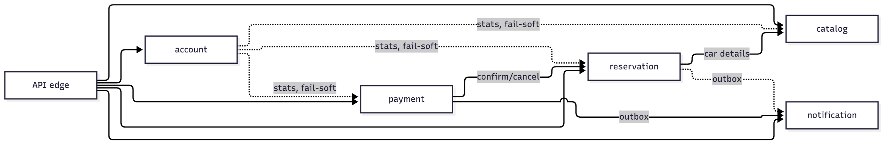
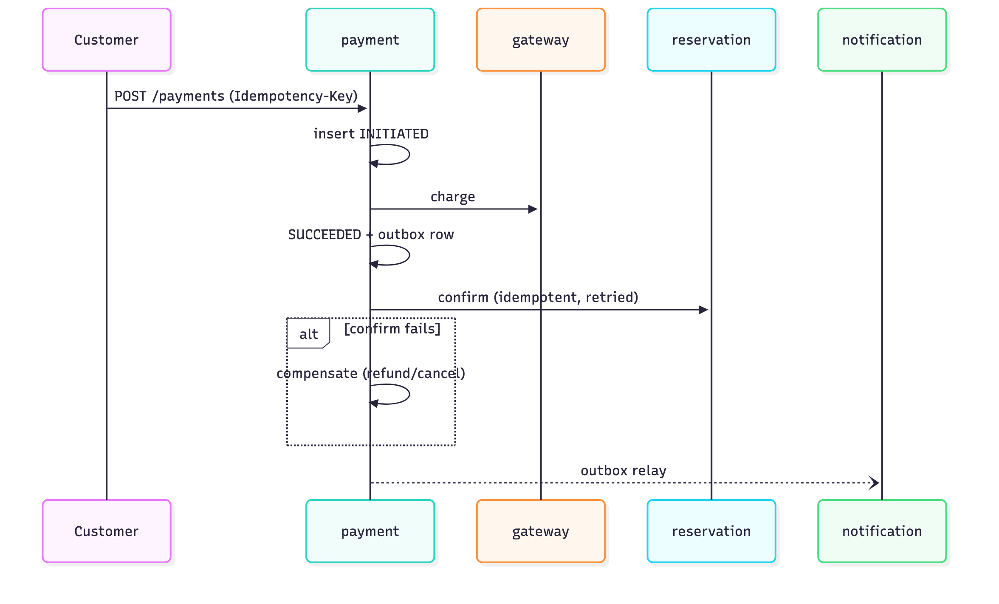
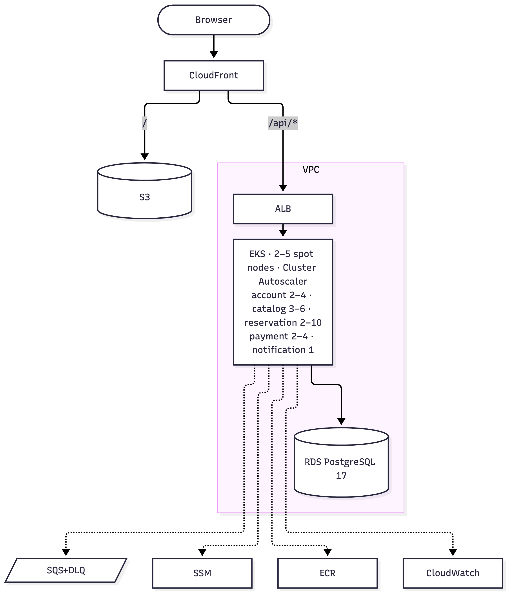
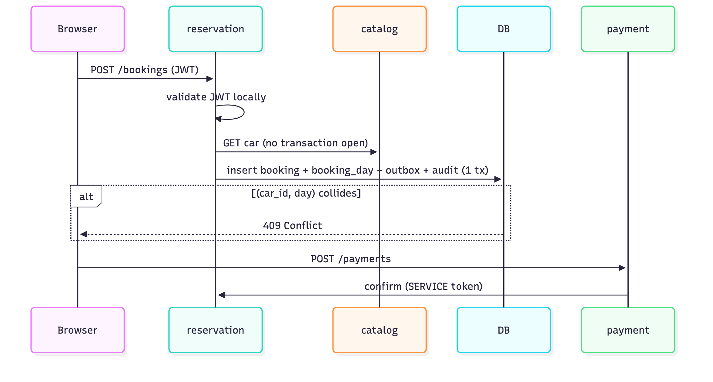
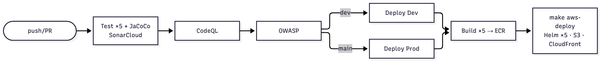
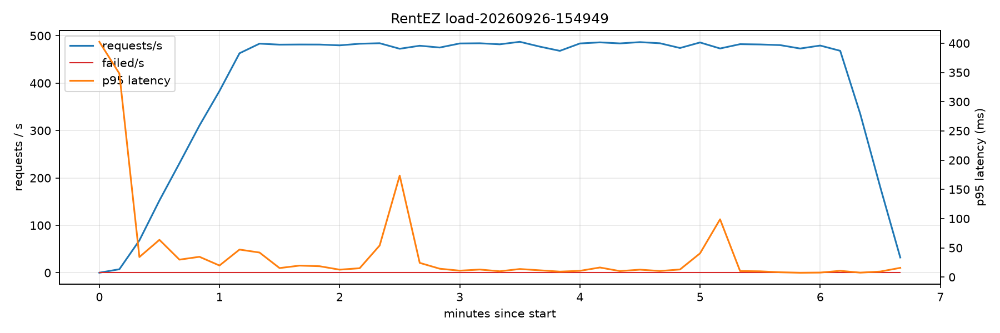
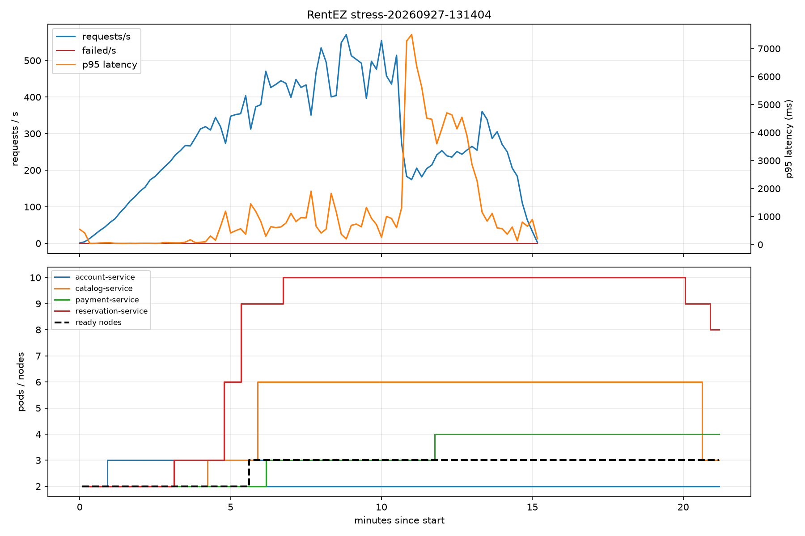

<!-- Superseded by docs/RentEZ-Presentation.pptx (built on the NUS-ISS template). MVP slide deck. Render with Marp (VS Code "Marp for VS Code" extension, or `npx @marp-team/marp-cli docs/presentation-slides.md --pptx`).
     Speaker notes and full detail: docs/presentation.md -->

# RentEZ
### A car rental platform on five independently deployable microservices

Graduate Certificate in Architecting Scalable Systems (NCS) · Practice Project
16 Oct 2026

Group 2 · John Ling · Sachin Agrawal · Quek Shen An · Muhammad Nur Hakim Bin Azman

---

<!-- ===================== 1. OVERVIEW (2+1) ===================== -->

## The business problem: a car exists once

| Problem | Our answer |
|---|---|
| Two customers book the same car at the same moment | DB rejects the second — `(car_id, day)` primary key |
| Money and inventory must agree | Payment saga + idempotency + reconciliation |
| Old receipts must survive repricing | Car details snapshotted onto the booking |
| Car in maintenance must vanish from availability | Status change in the same transaction |
| Notification failure must not fail a booking | Transactional outbox |

<!-- Frame the talk: how do you keep "a car exists once" true when the data is split across five services that can't see each other's tables? -->

---

## Platform thinking & scope

**Platform**
- **Producers** — staff/admin publish fleet, maintenance, pricing · services publish domain events
- **Consumers** — customers search, book, pay · notification consumes events
- Reusable capabilities: identity, catalog, reservation, payment, notification
- Self-service infra: `make aws-up-dev` / `aws-deploy-dev` / `aws-down-dev` — CI runs the same scripts

**In scope:** customer, staff and admin flows · AWS dev + prod · CI/CD with SAST/SCA · load/stress tests
**Out of scope:** real payment provider · refresh tokens · KEDA · multi-region

---

<!-- ===================== 2. PROJECT CONDUCT (1.5+0.5) ===================== -->

## Status & milestones

| When | Milestone |
|---|---|
| 27 Jul | Repo initialised |
| Aug | Services, gateway, Flyway, payment saga, outbox; frontend integrated (29 Aug) |
| Sep (early–mid) | AWS persistent/ephemeral layers, lease teardown, CloudWatch logs |
| 23–26 Sep | Load testing → pool deadlock fixed: **<50 → ≥400 actions/s** |
| 27–28 Sep | AWS stress tests, autoscaler fix, dev/prod fully separated, SonarCloud |

| Member | Area | Effort (person-days) |
|---|---|---|
| John Ling | DevOps | _TBD_ |
| Sachin Agrawal | Frontend | _TBD_ |
| Quek Shen An | Architecture | _TBD_ |
| Muhammad Nur Hakim Bin Azman | Backend | _TBD_ |

**Outstanding:** CPU-based HPA lags pool exhaustion · frontend tests off in CI · no token revocation / refresh · CloudFront masks API 404s · BIGINT ids public

---

<!-- ===================== 3. LOGICAL ARCHITECTURE (7+2) ===================== -->

## Key logical decisions

| Decision | Why |
|---|---|
| Database-per-service (schema + role, no grants) | Real boundaries — `make db-isolation` proves it |
| No cross-service joins: snapshot or call the owner | Schemas stay private |
| No distributed transactions: idempotency + saga | Retries must be safe |
| **Acyclic dependencies** — availability lives in reservation | A cycle = nothing deploys alone |
| Stateless JWT, validated locally | Identity is never a runtime bottleneck |
| Degrade, don't cascade — `partial: true`, `null` not `0` | A down service must not read as "revenue is 0" |

---

## Logical component view

- **Catalog and notification call nothing** · **nothing calls account at runtime**
- Solid = synchronous · dashed = async / fail-soft

<!-- Diagram sources: slides-diagrams/*.mmd -->

---

## Domain-Driven Design

| Bounded context | Aggregates | Relationship |
|---|---|---|
| Identity (account) | User, Role | Published language = JWT claims |
| Fleet (catalog) | Car, Maintenance | Open host service, upstream |
| Booking (reservation) | Booking, BookingDay | Snapshot = anti-corruption layer |
| Payments | Payment, Refund | Customer/supplier via idempotent confirm |
| Notification | Notification | Conformist event consumer, de-dup on `event_id` |

- Domain events via **transactional outbox** (broker-ready: HTTP → SQS swaps only the sink)
- Invariants enforced in the aggregate's own store
- Public APIs = DTOs only · `/internal/**` blocked at edge **and** needs a `SERVICE` token

---

## Payment saga

**Write before you call** — money never moves unrecorded · same key → same payment

---

<!-- ===================== 4. PHYSICAL ARCHITECTURE (7+2) ===================== -->

## Key physical decisions

| Decision | Trade-off |
|---|---|
| CloudFront sole entry: `/` → S3, `/api/*` → ALB | No CORS, no cert, no domain |
| One ALB via IngressGroup | ~1/5 LB cost |
| Spot nodes, no NAT gateway | ~70% cheaper; pods stateless |
| Persistent (~$0.80/mo) vs ephemeral (~$0.21/hr) + **lease Lambda** | A forgotten cluster can't become a $155 month |
| RDS **per environment**, 5 schemas inside | Dev load can't starve prod |
| Pool of 3, 2 s timeout, HTTP timeouts | 25 pods × 3 < ~112 conns; overload → fast 503 |

---

## Physical deployment view

Spring Boot 4.1 / Java 21 · React + Vite · Helm (1 chart × 5) · eksctl · CloudFormation · Fluent Bit
Two environments (`rentez-dev`, `rentez-prod`): own cluster, namespace, URL, RDS, logs

---

## Persistence design

- Schema-per-service, own role · FKs within a schema, **plain ids across**
- Flyway owns the schema (`ddl-auto=validate`), migrations immutable
- **Invariants the database enforces:**
  - `booking_day (car_id, day)` PK → no double-booking
  - `idempotency_key` UNIQUE → safe payment retries
  - generated `succeeded_booking_id` + UNIQUE → one *successful* payment per booking
  - outbox per producer · consumer de-dups on `event_id`
- Snapshot on booking: make, model, type, daily rate

---

## Representative use case: book & pay

`ConcurrentBookingTest`: 8 threads race for one car → exactly one wins

---

<!-- ===================== 5. DEVOPS (6+1) ===================== -->

## Source & artifact management

- `feature/**` → PR → `dev` (deploys dev) → PR → `main` (deploys prod) · both protected
- `sync-main.yml` auto-PRs `main` into open feature branches · CODEOWNERS reviewers
- Monorepo, **no shared library / parent POM** → every service builds alone
- Artifacts: ECR `rentez-<service>` tagged short + full SHA · frontend in S3 · Helm values per service

---

## DevOps pipeline

- CI runs **the same `make aws-deploy`** developers run
- Deploys **the commit CI tested** (`head_sha`), only if CI succeeded
- GitHub Environment picks cluster / namespace / DB inside one account (OIDC role)

---

## Findings: only visible under load (71 tests green)

| Finding | Symptom | Fix |
|---|---|---|
| Audit in `REQUIRES_NEW` → 2nd connection | Deadlock at 50/s, **CPU < 1%** | Join caller's tx |
| Connection held across HTTP calls | Pool starved | Call with no tx open |
| 30 s pool wait, no HTTP timeouts | Backlog never drained | 2 s + timeouts → fast 503 |
| Errors re-dispatched as anonymous | Every failure = **401** | Permit `ERROR` dispatch |
| Autoscaler v1.35 on k8s 1.31 | 8 pods Pending 15 min | Pin v1.31.5 + version guard |

**Blocked services don't burn CPU — the HPA couldn't help until these were fixed.**

---

## Other findings

- Deploy Dev was shipping **`main`'s code** (`github.sha` in `workflow_run`)
- `prod.yml` briefly lacked the "CI succeeded" guard
- Internal-deny rule hardcoded namespace → broke fresh dev cluster
- Missing notification ingress → CloudFront returned `index.html` with **200**
- H2 ≠ PostgreSQL → Testcontainers only · entities leaked BCrypt hashes → DTO-only
- Missing `@EnableMethodSecurity` silently disables `@PreAuthorize`

---

<!-- ===================== 6. DEMO (8+2) ===================== -->

## Demo — use cases

1. Customer: browse → availability → book → pay → notification
2. Two concurrent bookings, same car → `201` + `409`
3. Replay payment with same `Idempotency-Key` → original returned
4. Staff: car to maintenance → gone from availability
5. Admin: stop payment-service → dashboard `partial: true`, revenue `null`

<!-- Backup recording required. Bring up the environment ≥30 min before. -->

---

## Performance: <50 → ≥400 actions/s

| Rate | Before | After | p95 | p99 | Errors |
|---|---|---|---|---|---|
| 50/s | **FAIL** (16% err, p95 60 s) | PASS | 22 ms | 50 ms | 0% |
| 100/s | **FAIL** | PASS | 31 ms | 164 ms | 0% |
| 400/s | **FAIL** | **PASS** | **18 ms** | **67 ms** | **0%** |

AWS, 100/s: **p95 56 ms · p99 97 ms · 0% errors**
Same infrastructure, same 3-connection pools

---

## Scalability: capacity follows demand

CPU > 60% (min 3) → reservation **2 → 10 pods** → Pending → **3rd node** (min 5) → CPU ~200% → ~60% **at peak load** → scale-down after 300 s

<!-- Live: watch -n5 kubectl get hpa,nodes -n rentez-prod  +  make perf-spike TARGET=aws -->

---

## Known limits — findings, not failures

- **CPU is the wrong signal** for pool exhaustion (catalog: pools dry at 70–90% CPU) and for queue consumers (notification) → KEDA
- **RDS `db.t4g.micro` is the ceiling** → RDS Proxy / bigger class
- **HPA maximums cap peak** (reservation 10, catalog 6 maxed, node half-empty)
- 300 s scale-down is deliberate (no spot thrashing)

**Next:** KEDA · RDS Proxy · ULID public ids · refresh tokens + revocation · fix CloudFront 404 masking

---

# Thank you — Q&A

RentEZ: correctness enforced by the database · no dependency cycles · scalability proven with evidence
