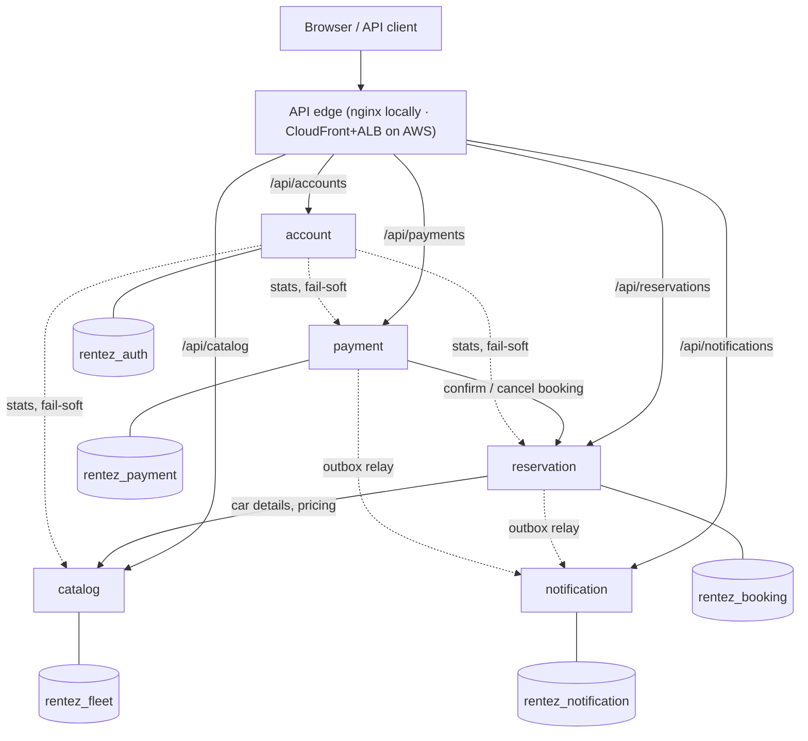
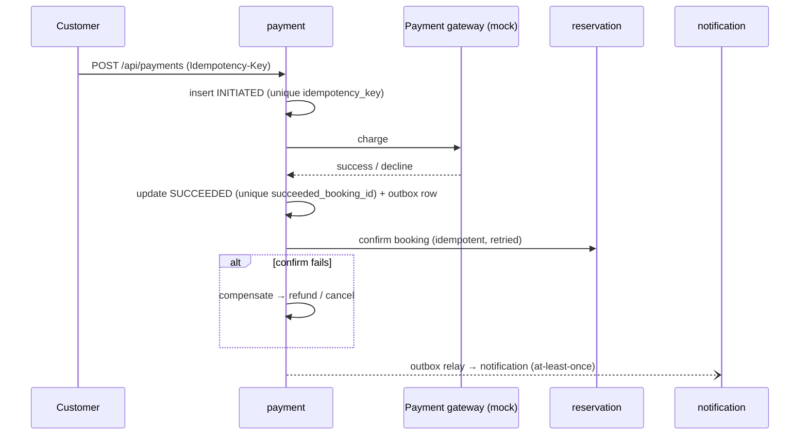
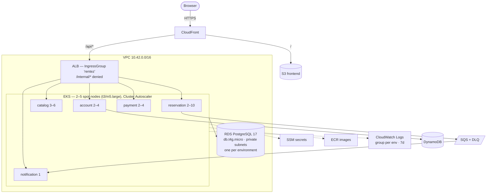
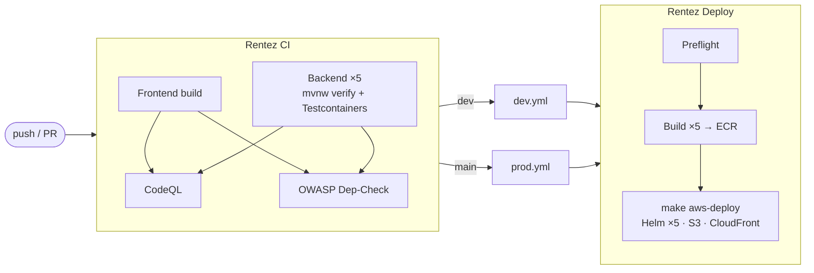

# RentEZ — Practice Project Presentation

> Graduate Certificate in Architecting Scalable Systems (NCS) · **Group 2** · **16 Oct 2026, 3:30 PM SGT (Zoom)** · 40 min including Q&A
>
> Structure follows *Project Presentation Guidelines V2.8*. Each section lists **slides** (what goes on screen) and **talking points** (what to say — don't read the slides). Timings are `talk + Q&A`.
>
> Slides: [RentEZ-Presentation.pptx](RentEZ-Presentation.pptx) · Script: [presentation-outline.md](presentation-outline.md)
>
> Related: [README](../README.md) · [Architecture](architecture.md) · [CI/CD](cicd-pipeline.md) · [Branching](branching-strategy.md) · [Quality attributes](quality-attributes.md) · [Schema](ch02.database-schema.adoc) · [Verification](ch03.verifying-the-services.adoc)

| # | Section | Time | Presenter |
|---|---|---|---|
| 1 | Overview | 2 + 1 | _TBD_ |
| 2 | Project Conduct | 1.5 + 0.5 | _TBD_ |
| 3 | Logical Architecture & Design | 7 + 2 | _TBD_ |
| 4 | Physical Architecture & Design | 7 + 2 | _TBD_ |
| 5 | DevOps & Development Lifecycle | 6 + 1 | _TBD_ |
| 6 | Demo | 8 + 2 | _TBD_ |
| | **Total** | **31.5 + 8.5 = 40** | |

**The three things the audience should remember** (tip 1 — unique aspects, not similarities):

1. **Correctness is enforced by the database, not by hope** — a composite primary key makes double-booking impossible; unique indexes make payments idempotent.
2. **A dependency graph with no cycles** — catalog and notification call nothing; nothing calls account at runtime. Every service builds, tests and deploys alone.
3. **Evidence, not claims** — load testing took supported throughput from **<50 to ≥400 actions/s with no new infrastructure**, by finding bugs 71 green tests never showed; on AWS the HPA took reservation 2 → 10 pods and the Cluster Autoscaler added a node under stress.

(Supporting: infrastructure with a lease — persistent/ephemeral split, a Lambda that tears down a forgotten cluster, ~$0.21/hour instead of a $155 month.)

---

## 1. Overview (2 + 1 min)

### Slide 1.1 — Title
RentEZ · car rental platform · five independently deployable microservices on AWS EKS · team names.

### Slide 1.2 — The business problem
A car exists **once**. Almost every hard problem follows from that:

| Problem | Our answer |
|---|---|
| Two customers click "Book" on the same car at the same moment | DB rejects the second — `(car_id, day)` primary key |
| Money and inventory must agree | Payment saga + idempotency + reconciliation sweeper |
| Last year's receipt must still make sense after repricing | Car details snapshotted onto the booking |
| Car goes to maintenance → must vanish from availability now | Maintenance and status change in one transaction |
| Notification failure must never fail a booking | Transactional outbox, delivered off the request path |

### Slide 1.3 — Platform thinking
- **Producers** (staff/admin publish fleet, maintenance, pricing) and **consumers** (customers search, book, pay) meet on one platform through a single API edge.
- Capabilities are **reusable platform services**, not a monolith: identity (JWT, validated locally everywhere), catalog, reservation, payment, notification.
- **Self-service infrastructure**: any teammate runs `make aws-up` / `make aws-deploy` / `make aws-down`; CI runs the *same* scripts.
- **Extensible**: adding a service is a documented recipe (payment-service was added this way); outbox is broker-ready (HTTP → SQS swap touches only the relay sink).

### Slide 1.4 — Scope
- **In:** customer browse / availability / book / pay / notifications; staff fleet & maintenance; admin users, refunds, dashboard; AWS deployment (dev + prod); CI/CD with SAST/SCA; load, stress and spike tests.
- **Out (deliberately):** real payment provider (mock gateway), refresh tokens, KEDA queue-based scaling, multi-region.

**Talking points:** Open with the "a car exists once" line. Frame the rest of the talk as *how do you keep that true when the data is split across five services that can't see each other's tables*.

---

## 2. Project Conduct (1.5 + 0.5 min)

### Slide 2.1 — Status
- ✅ 5 services + React frontend, 71 backend tests (Testcontainers PostgreSQL 17), 33-check smoke test.
- ✅ Running on AWS: CloudFront → ALB → EKS → RDS, two **fully separate** environments (`rentez-dev`, `rentez-prod`) — own cluster, namespace, RDS instance, CloudFront URL and log group.
- ✅ CI/CD: test + JaCoCo → SonarCloud → CodeQL → OWASP → build to ECR → Helm deploy of the exact commit CI tested.
- ✅ k6 load / stress / spike suite run locally and on AWS, with results and scaling charts in [quality-attributes.md](quality-attributes.md).
- ⚠️ **Outstanding issues:**
  - CPU-based HPA scales late when the bottleneck is the connection pool (catalog in the dev stress run) → KEDA / pending-connections metric is future work.
  - Frontend test step commented out in CI (build only).
  - DynamoDB tables (sessions/availability/audit) provisioned but unused → no real token revocation.
  - No refresh tokens (15-min expiry → re-login).
  - Stranded `INITIATED` payments not swept (mock gateway can't be queried).
  - CloudFront 403/404 → `index.html` rewrite also masks API 404s.
  - BIGINT ids exposed publicly (ULID `public_id` designed, not implemented).
  - notification-service has no autoscaling (needs KEDA on queue depth).

### Slide 2.2 — Milestones & effort

| Date | Milestone |
|---|---|
| 27 Jul 2026 | Repository initialised |
| early Aug | CI + frontend test setup; service decomposition and schemas |
| Aug | Core services, gateway, Flyway migrations, payment saga, outbox |
| 29 Aug | Frontend integrated with services; main deployment workflow |
| 5 Sep | Frontend service deployed; pipeline stabilised |
| mid Sep | AWS persistent/ephemeral layers, lease teardown, dev/prod environments |
| 20 Sep | CloudWatch logging via Fluent Bit; notification ingress fix; CI role discovery |
| 22 Sep | JaCoCo coverage for SonarQube |
| 23–26 Sep | Local load testing: connection-pool deadlock found and fixed (#52) — <50 → ≥400 actions/s |
| 27 Sep | AWS load/stress tests; Cluster Autoscaler version fix; dev/prod fully separated (#54); real status codes, catalog headroom, per-env DBs and logs, PostgreSQL 17 (#55); SonarCloud in CI |
| 28 Sep | CI workflow update (#56); internal-deny rule per namespace |
| Oct | Final rehearsal runs, presentation prep |

| Member | Role | Main contributions | Effort |
|---|---|---|---|
| John Ling | DevOps | AWS infrastructure, CI/CD, SonarCloud | _fill in_ |
| Sachin Agrawal | Frontend | React SPA, booking and admin pages | _fill in_ |
| Quek Shen An | Architecture | Service boundaries, saga, load testing | _fill in_ |
| Muhammad Nur Hakim Bin Azman | Backend | Spring Boot services and APIs | _fill in_ |

> Roles confirmed by the team; fill in effort.

---

## 3. Logical Architecture & Design (7 + 2 min)

### Slide 3.1 — Key architectural decisions (logical)

| Decision | Why |
|---|---|
| **Database-per-service** (schema + role, no cross-schema grants) | Real boundaries; `make db-isolation` proves `auth_user` can't read `rentez_booking` |
| **No cross-service joins** — snapshot at write time or call the owner's API | Schemas stay private; bookings survive car repricing/deletion |
| **No distributed transactions** — idempotency + compensation (saga) | Two systems can't share a commit; retries must be safe |
| **Acyclic dependency graph** — availability lives in *reservation*, not catalog | A cycle means neither service can be deployed alone |
| **Stateless auth** — JWT validated locally, role/userId in claims | Identity is never a runtime bottleneck or SPOF |
| **Degrade, don't cascade** — admin dashboard returns `partial: true`, `null` not `0` | A down service must not read as "revenue is zero" |

### Slide 3.2 — Logical component view



Solid = synchronous on the request path. Dashed = async or fail-soft. **Catalog and notification have zero outbound dependencies; nothing calls account at runtime.**

### Slide 3.3 — Domain-Driven Design

| Bounded context | Aggregate(s) | Upstream / downstream |
|---|---|---|
| Identity & Access (account) | User, Role | Published language = JWT claims; no runtime callers |
| Fleet (catalog) | Car, MaintenanceRecord | Upstream to reservation (open host service) |
| Booking (reservation) | Booking, BookingDay | Downstream of Fleet (snapshot = anti-corruption), upstream of Payment |
| Payments | Payment, Refund | Customer/supplier with Booking via idempotent confirm/cancel |
| Notification | Notification | Conformist consumer of domain events (de-dup on `event_id`) |

- **Domain events** (`BookingCreated`, `PaymentSucceeded`, …) published via **transactional outbox** — business change and event commit atomically.
- **Invariants live in the aggregate's own store**: one car per day (`booking_day` PK); at most one *successful* payment per booking (generated column + unique index).

### Slide 3.4 — Producers & consumers on the platform
- **Producers:** staff/admin publish vehicles, status, maintenance, pricing (catalog); services publish domain events (outbox).
- **Consumers:** customers query availability and book; notification consumes events; admin dashboard consumes stats fail-soft.
- **Contracts:** DTOs only (entities never leave a controller); public vs `/internal/**` APIs — internal is blocked at the edge *and* requires a `SERVICE`-role token.

### Slide 3.5 — Payment saga (supporting view)



**Talking points:** "Write before you call" — payment is inserted `INITIATED` *before* the gateway call so money never moves unrecorded. Retried request with same key returns the original payment.

---

## 4. Physical Architecture & Design (7 + 2 min)

### Slide 4.1 — Key architectural decisions (physical)

| Decision | Trade-off |
|---|---|
| CloudFront is the **only** public entry; serves SPA at `/`, proxies `/api/*` | Same origin → no CORS, no certificate, no domain to buy |
| **One ALB** via IngressGroup (not five) | ~1/5 of LB cost |
| **Spot nodes**, no NAT gateway | ~70% cheaper; stateless pods, state in RDS |
| **Persistent vs ephemeral layers** + lease Lambda | ~$0.80/month idle, ~$0.21/hour running; can't forget a cluster |
| One RDS instance **per environment**, five schemas/roles inside | Dev under load cannot starve prod; any service can still move to its own DB by connection string only |
| Hikari pool of **3** per pod, 2 s connection timeout, HTTP client timeouts | 25 max pods × 3 = 75 < `db.t4g.micro`'s ~112; overload fails fast (503) and drains instead of queueing for 30–60 s |

### Slide 4.2 — Physical deployment view



**Technologies:** Spring Boot 4.1 / Java 21 · React + Vite · PostgreSQL 17 + Flyway · Spring Security OAuth2 resource server (JWT) · Helm (one chart, installed five times) · eksctl · CloudFormation · Fluent Bit · k6.

Two environments (`dev`, `prod`) in one account: separate cluster, namespace, CloudFront URL, RDS instance and log group; only the VPC and ECR are shared. `make aws-up-dev` / `aws-up-prod` etc.; a bare `make aws-up` asks which one rather than guessing, and one environment's teardown can't reach the other's.

### Slide 4.3 — Persistence design
- **Schema-per-service** on one PostgreSQL; own role each; no cross-schema FKs (plain ids), FKs mandatory *within* a schema.
- **Flyway owns the schema** (`ddl-auto=validate`); migrations immutable.
- Money, time, soft-delete, identifier conventions — see [`ch02.database-schema.adoc`](ch02.database-schema.adoc) (30+ tables).
- **DB-enforced invariants:**
  - `booking_day (car_id, day)` PK → no double-booking.
  - `payment.idempotency_key` UNIQUE → safe retries.
  - Generated `succeeded_booking_id` + UNIQUE → one successful payment per booking, unlimited declines.
  - `outbox` table in each producer schema; consumer de-dups on `event_id`.
- Snapshot columns on booking: `car_make`, `car_model`, `car_type`, `daily_rate_snapshot`.
- DynamoDB (sessions / availability / audit) provisioned for future use.

### Slide 4.4 — Architecturally representative use case: *Customer books and pays for a car*

```mermaid
sequenceDiagram
    participant B as Browser
    participant CF as CloudFront/ALB
    participant R as reservation
    participant C as catalog
    participant DB as rentez_booking
    participant P as payment
    B->>CF: POST /api/reservations/bookings (JWT)
    CF->>R: route by path
    R->>R: validate JWT locally (no call to account)
    R->>C: GET car (details + rate) — no transaction open
    Note over R: never hold a DB connection across an HTTP call
    R->>DB: BEGIN; insert booking (snapshot) + booking_day rows + outbox + audit; COMMIT
    alt (car_id, day) collides
        DB-->>R: unique violation → 409 Conflict
    end
    R-->>B: 201 PENDING
    B->>P: POST /api/payments (Idempotency-Key)
    P->>R: confirm booking (internal, SERVICE token)
    R-->>P: CONFIRMED
    P-->>B: 201 SUCCEEDED
```

Why this one: it touches every architectural decision — local JWT, cross-service read, snapshot, DB-enforced concurrency, saga, idempotency, outbox. `ConcurrentBookingTest` races 8 threads for one car and asserts exactly one wins.

---

## 5. DevOps & Development Lifecycle (6 + 1 min)

### Slide 5.1 — Source & artifact management
- **Branching:** `feature/**` → PR → `dev` (deploys to dev) → PR → `main` (deploys to prod). Both protected: PR + green CI.
- **sync-main.yml** auto-opens auto-merging PRs from `main` into every open feature branch (uses a PAT so the sync PRs are themselves tested).
- **CODEOWNERS** auto-assigns reviewers.
- **Monorepo, no shared library, no parent POM** — every service is a standalone Maven project with its own Docker context → independent builds.
- **Artifacts:** images `rentez-<service>` in ECR tagged short + full commit SHA; frontend bundle in S3; Helm values per service.

### Slide 5.2 — Pipeline



- CI deploys by running **the same `make aws-deploy`** developers use — no YAML reimplementation.
- `aws-up` (provision, ~20 min) vs `aws-deploy` (code only, ~3 min).
- GitHub Environment picks *where in the account* a run lands (`CLUSTER_NAME`, `NAMESPACE`, `DB_NAME`… per Environment), via OIDC-assumed role.
- **Deploys the commit CI tested** (`workflow_run.head_sha`), once per merge — and only if CI concluded `success`.
- JaCoCo coverage per service → **SonarCloud** analysis (`rentez-<service>` projects) in the backend matrix.

### Slide 5.3 — Procedures
- `make check` → `make up` → `./scripts/smoke.sh` (33 checks) locally.
- `make aws-status` shows who holds the cluster, burn rate, lease time left.
- `make aws-down` dumps DB to S3 then destroys hourly-billed resources.
- Logs shipped to CloudWatch, one group per environment (`/rentez/cluster`, `/rentez/dev/cluster`, 7-day retention) so they outlive the ephemeral cluster; `make aws-logs-dev S=<service>`.

### Slide 5.4 — Technical findings & issues encountered

**Found only under load — all 71 tests were green** (the strongest story in the talk):

| # | Finding | Symptom | Fix |
|---|---|---|---|
| 1 | Audit logged in `REQUIRES_NEW` → every write took a **second** connection | Pool of 3 deadlocked; collapse at 50 actions/s with **CPU < 1%** | Audit joins the caller's transaction |
| 2 | DB connection held across HTTP calls (booking → catalog, outbox → notification) | Pool starved by network waits | Remote call made with no transaction open |
| 3 | 30 s Hikari wait, no HTTP timeouts | Backlog fed itself, never drained | 2 s pool timeout + HTTP client timeouts → fast 503 |
| 4 | Error re-dispatch to `/error` treated as anonymous | Every failure looked like **401** (~11,000 in one run) | `DispatcherType.ERROR` permitted in all five `SecurityConfig`s |
| 5 | Cluster Autoscaler v1.35 on a 1.31 cluster | Main loop never ran; 8 pods Pending 15 min on 2 of 5 nodes | Pinned v1.31.5; `aws-up` refuses a mismatched minor |

**Why it matters:** blocked services don't burn CPU, so the CPU-based HPA could never have helped until these were fixed.

**Pipeline & environment findings:**
- **Deploy Dev shipped `main`'s code** — inside `workflow_run`, `github.sha` is the default branch. Now passes `head_sha`.
- **`prod.yml` lacked the `conclusion == 'success'` guard** for a while — a red CI could deploy to prod.
- **Internal-deny rule hardcoded namespace `rentez`** → failed on a fresh `rentez-dev` cluster; now applied per namespace.
- Separating dev from prod exposed teardown reaching across environments and interleaved logs — fixed with per-env names everywhere.

**Earlier findings:**
- **H2 ≠ PostgreSQL** — `year` is reserved in H2 (hence `model_year`); moved all tests to Testcontainers.
- **Entities leaked BCrypt hashes** in the original code → DTO-only rule.
- **Missing `@EnableMethodSecurity`** silently turns every `@PreAuthorize` into a no-op.
- **notification-service had no ingress** → CloudFront returned `index.html` with **200** for API calls; fixed with ingress at `group.order 104`.
- **CloudFront SPA rewrite masks API 404s** (still open).
- **Connection pool × HPA** — pool of 3 per pod keeps max pods within `db.t4g.micro`'s connection budget; the DB is the scaling ceiling.
- **Fluent Bit:** only the AWS build has the CloudWatch plugin; tails from end, so pre-start logs are lost.
- **CI role** discovered rather than hard-coded; stopped masking `Unauthorized`.

---

## 6. Demo (8 + 2 min)

> **Backup first:** the charts already recorded in [`docs/perf/`](perf/) (`aws-stress-after-ca-fix.png`, `load-400-after.png`, …) plus a k6 `report.html` and a screen recording of the use-case flow before the day. Spot capacity and a 20-minute `aws-up` are not things to gamble on live. Run `make aws-up-prod` (or `-dev`) ≥ 30 min before 3:30 PM and check the lease covers the session.

### 6a. Significant use cases (~4 min)
1. **Customer** (`customer@nusiss.edu`): browse fleet → search availability by location/type/dates → book → pay → see notification + unread count.
2. **Double-booking**: fire two concurrent bookings for the same car/dates → one `201`, one `409`.
3. **Idempotent payment**: resend `POST /api/payments` with the same `Idempotency-Key` → original payment returned, no second charge.
4. **Staff**: put a car into maintenance → it disappears from availability.
5. **Admin**: dashboard; stop payment-service → dashboard shows `partial: true`, revenue `null` (not `0`).

### 6b. Quality attributes (~4 min)

| Attribute | Show | Evidence |
|---|---|---|
| **Performance** | `make perf-load TARGET=aws` (or recorded) | k6 SLO table: error < 1%, p95 < 500 ms, p99 < 1 s; per-endpoint p95 |
| **Scalability** | `make perf-spike TARGET=aws` + `watch -n5 kubectl get hpa,nodes -n rentez` | Replicas rise within ~1 min → Pending pods → new node in ~3–5 min → latency recovers |
| **Maintainability** | Push a small change to a feature branch → PR to `dev` | CI (test, CodeQL, OWASP) → deploy workflow → new image SHA running |
| **Cost / operability** | `make aws-status` | Burn rate, lease deadline, who holds the cluster |

**Narration for the spike:** "Spike hits → CPU column jumps past 60% → replica count moves → pods go Pending → Cluster Autoscaler adds a node → latency on the k6 dashboard settles. Capacity followed demand." Then show `chart.png` and the SLO table.

### Results (from [quality-attributes.md](quality-attributes.md))

**Performance — local, before vs after the load-test fixes** (one instance per service, pools of 3):

| Rate (actions/s) | Before | After | p95 | p99 | Errors |
|---|---|---|---|---|---|
| 50 | **FAIL** (16% errors, p95 60 s) | PASS | 22 ms | 50 ms | 0% |
| 100 | **FAIL** | PASS | 31 ms | 164 ms | 0% |
| 200 | **FAIL** | PASS | 13 ms | 35 ms | 0% |
| 400 | **FAIL** | **PASS** | **18 ms** | **67 ms** | **0%** |

→ **<50 → ≥400 actions/s** (~418 req/s, roughly 2,000–4,000 concurrent users) with no new infrastructure. 400/s is a floor; the ceiling wasn't reached locally. Slides: `load-100-before.png` vs `load-100-after.png`.

**Performance & scalability — AWS** (EKS 1.31, spot t3/m5.large, `db.t4g.micro`, traffic via CloudFront):

| Test | Load | p95 | p99 | Errors | Most pods (res/cat/pay/acc) | Nodes |
|---|---|---|---|---|---|---|
| load | 100/s | **56 ms** | **97 ms** | **0%** | 9 / 5 / 4 / 4 | 2 |
| stress, before CA fix | ramp to 300 users (~317 req/s) | 1.24 s | — | 1.16% | 10 / 6 / 4 / 2 | **2 (8 pods Pending ~15 min)** |
| stress, after CA fix | ramp to 300 users (~290 req/s) | 1.02 s | — | 0.99% | 10 / 6 / 4 / 3 | **2 → 3** |
| dev env stress | ramp to 300 users (~249 req/s) | 2.66 s | — | 4.86% (limit 5%) | 10 / 3–4→6 / – / – | 4 (already up) |

**Story for the scalability chart (`aws-stress-after-ca-fix.png`):** reservation CPU crosses 60% at minute 3 → HPA 2 → 10 pods by minute 6 → 3 pods unplaceable → Cluster Autoscaler adds a 3rd node at minute 5, Pending clears within a minute → per-pod CPU falls ~200% → ~60% **while load is still at peak** → after load stops, replicas hold for 300 s then shrink.

**Dev stress run (`aws-dev-stress-catalog.png`) — the honest finding:** 10,885 of 11,013 errors were on catalog. Its pools ran dry while CPU was only 70–90%, so the CPU-based HPA scaled late (max 6 at minute 11). Response: catalog `minReplicas` 2 → 3 now; proper fix is scaling on `hikaricp.connections.pending` via KEDA.

> Re-run the stress test on the post-#55 build (catalog min 3, real status codes) before 16 Oct and add the row here.

**Known limits to state honestly:**
- CPU is the wrong scaling signal for pool exhaustion (catalog) and for queue consumers (notification has no HPA) → KEDA future work.
- RDS `db.t4g.micro` is the ceiling — Postgres was already the busiest container at 400/s locally; more pool needs RDS Proxy or a bigger class.
- HPA maximums cap peak throughput — at 300 users reservation (10) and catalog (6) were maxed with the 3rd node half-empty.
- 300 s scale-down window is deliberate to avoid thrashing spot nodes.

---

## Q&A prep — likely questions

| Question | Short answer |
|---|---|
| Why not a message broker everywhere? | Outbox gives atomicity now; transport is HTTP, SQS swap touches only the relay sink. |
| Why one RDS for five services? | Cost. Isolation is by schema + role + no grants; moving a service out is a connection-string change. Each *environment* has its own instance so dev load can't hurt prod. |
| Your tests all passed — how did you miss the deadlock? | Tests aren't concurrent at pool size. That's exactly why we load-test: five defects only appeared under concurrency, and the headline number went from <50 to ≥400 actions/s. |
| Why do you still get errors at peak on AWS? | HPA bounds reached (reservation 10, catalog 6) and CPU lags pool exhaustion. Fixes: raise bounds within the RDS budget, scale on pending connections. |
| How do you revoke a user? | Currently can't until token expiry (15 min). DynamoDB sessions table is the planned fix. |
| What if payment succeeds but confirm times out? | Confirm is idempotent and retried; reconciliation sweeper finishes interrupted sagas; compensation cancels/refunds. |
| Why not Kafka / service mesh? | Scale doesn't justify the operational cost; the design keeps those as drop-in options. |
| Why spot nodes for "production"? | Stateless pods behind an LB; interruption loses nothing. For real prod, mix on-demand baseline. |
| What would you do next? | KEDA (pending connections for catalog, queue depth for notification), RDS Proxy, ULID public ids, refresh tokens + revocation, fix CloudFront API 404 masking, re-enable frontend tests. |
